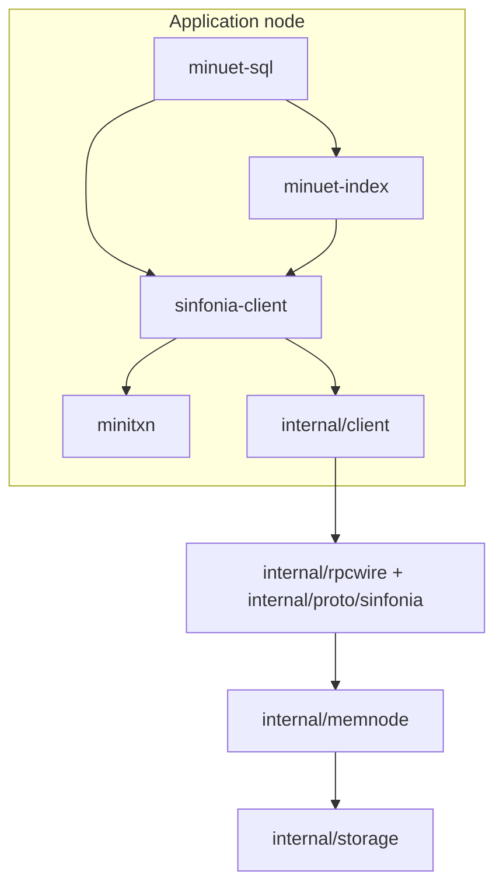

# How it works

## The layers

The Sinfonia user library and coordinator run in the application process. The
library provides reads, writes, and transactions. Index and SQL code
use the same client and transaction result types; the coordinator and RPC details
are internal implementation packages.

`sinfonia-client.NewClient` takes a map from memory node IDs to `NodeConfig`
values and creates the coordinator for those nodes. Each configuration supplies
an RPC address. Nodes serve TCP RPC; no HTTP administration or metrics endpoints
are exposed.

The client owns its coordinator workers and RPC connections. `Client.Close`
drains queued decisions, joins the workers, and closes connections. Callers must
finish all API calls first and must not use the client afterward except to close
it again. Delivery uses the existing RPC timeouts; there is no overall shutdown
deadline. Close reports delivery errors without changing the known decision.
Internal coordinators borrow participants and leave their closure to the owner.

`MiniTransaction` holds comparisons, reads, and writes. It copies the supplied
bytes so changing the caller's buffer won't change the transaction. Its host
helpers return copies too. An `Executor` connects the builder to the client;
there's no global list of hosts. Public items use `HostId`, `Address`, and
`Length`; internal messages use `MemID`, `Addr`, and `Len`.

All application data access uses minitransactions. `Client.Read` and
`Client.Write` submit one read or write item through the coordinator's
single-participant path. Both respect prepared transaction locks and RPC
readiness. All memory nodes are durable. Raw read/write RPCs and
public participant access methods are removed; private byte-access helpers are
used only inside node operations.

These convenience methods return `ErrTransactionAborted` for an explicit
rejection and `ErrUnknownOutcome` when the outcome cannot be established. Separate
reads are separate transactions, so callers still need validation or a combined
minitransaction to obtain a snapshot across several ranges. Read-only and
compare-only minitransactions append neither redo nor decision records, including
on the single-participant path. Original replies are cached only in memory.

## Finding the participant code

The participant remains one type in `internal/memnode`. Its files separate the
main transaction path from recovery and supporting operations. Methods share
the same state and mutex; the split adds no package or API boundary.

| File | Responsibility |
| --- | --- |
| [participant.go](../internal/memnode/participant.go) | Shared state, construction, readiness, shutdown, and private byte-access helpers |
| [locking.go](../internal/memnode/locking.go) | Transaction range locks |
| [prepare.go](../internal/memnode/prepare.go) | Comparisons, reads, prepared writes, and yes/no votes |
| [commit.go](../internal/memnode/commit.go) | Applying commit/abort decisions and single-participant execution |
| [outcomes.go](../internal/memnode/outcomes.go) | Caching replies in memory and expiring transaction outcomes |
| [recovery.go](../internal/memnode/recovery.go) | Epoch floors, recovery evidence, and unfinished transactions |
| [maintenance.go](../internal/memnode/maintenance.go) | Applied notifications and log cleanup |

For the main walkthrough, follow `ExecAndPrepare` in `prepare.go` and then
`Commit` in `commit.go`. `ExecCommit1PC` handles the single-participant shortcut.

## A transaction

All byte addresses must be known before the transaction starts. For a transaction
that touches several nodes, the coordinator sends each node its part in parallel.
It first rejects any unconfigured node ID, before sending requests to any node.
Each participant tries to lock its ranges without waiting, checks comparisons,
collects reads, and logs prepared writes before voting yes.
A participant with no local writes still logs its yes vote if the transaction
writes elsewhere, so recovery can account for everyone's vote.

Readers can share locks. A writer needs exclusive access to its range. Both
transaction paths collect all nonempty compare/read ranges as shared locks and
write ranges as exclusive locks. Under the participant mutex, they check the
whole set against existing locks before installing any of it. Overlaps within
the same transaction are allowed; a partial overlap with its own write never
leaves the rest of a comparison or read unprotected. A rejected set installs no
locks. Successful prepares retain the set until commit or abort.

The lock scan checks all earlier readers that might overlap, including a long
reader hidden behind a shorter one. A lock conflict triggers backoff and a
bounded number of retries with fresh transaction IDs, for both single-participant
and multi-participant transactions. A failed comparison or other non-retryable
rejection aborts without retry, even if another participant reports a lock
conflict or stale epoch. The result preserves a non-retryable rejection as its
status regardless of reply order.

For ordinary transactions, everyone's yes vote establishes the commit decision.
The coordinator has no durable transaction log. Workers send decisions in the
background, so `ExecuteAndCommit` can return before all nodes have applied their
writes. `FlushPendingCommits` waits for delivery and reports delivery errors.
A transaction that touches just one participant uses a combined execute/commit
call instead.

If an RPC fails after the request might have arrived, the caller can't assume
the transaction aborted. This includes server errors after a saved vote or
commit decision; an error is not an abort vote. The API reports committed,
aborted, or unknown. An ambiguous result returns immediately without resolving or
retrying the operation. Both the direct client and transaction builder return
`ExecResult`, preserving uncertainty and its cause.
Participants cache replies in memory so duplicate requests can get the same
result without applying writes twice while the cache entry exists. After restart,
a transaction still retained in redo cannot execute again, but its original
response is unavailable. Cleanup discards this evidence; callers must not reuse
transaction IDs or blindly resubmit an uncertain mutation as a new transaction.

Transaction epochs are UTC hours since the Unix epoch, shared by coordinators
and participants regardless of when they start. Each process keeps its epoch
from moving backward. A participant rejects an unfamiliar transaction two or
more epochs behind; the coordinator learns newer epochs from replies and retries
an explicit stale-epoch rejection with a fresh transaction ID, within its retry
limit. This assumes roughly synchronized system clocks.

## Disk storage and recovery

Every node keeps its working data in memory and saves its memory image, redo
entries, decisions, forced-abort records, and applied-notification receipts to its
required data directory.
`memnode.NewParticipant` takes the node ID, image size, and directory. Callers
configure peers and complete `Recover` before serving application requests.
Both execution methods check readiness while holding the participant mutex,
before consulting cached replies, and hold that mutex through execution.
Recovery marks the node unready and snapshots redo under the same mutex. An
execution therefore finishes before that snapshot or is rejected until recovery
finishes; it cannot append a new write that an older replay then overwrites.
This applies to direct calls and RPCs. Commit delivery and recovery requests
remain available while the node is unready.
On restart the node uses those records and asks recovery
peers for evidence about unfinished transactions. Missing evidence can keep it
from finishing recovery or serving requests. A coordinator disappearing doesn't
give a prepared participant permission to abort on its own.

Each participant owns its disk image, including cleanup when construction
fails. After requests and externally started recovery workers have stopped,
`Participant.Close` closes the image. Each redo append writes and syncs its record
before returning success. Appends and compaction share the log mutex.

The configured memory size must match the existing image file exactly. Only a
newly created image is initialized to that size; mismatches fail startup without
resizing the image. Resizing existing images is not supported.

`redo.log` holds transaction IDs, participant IDs, and writes needed to recover
transaction effects. This follows Sinfonia's redo-log role: section 4.3 of the
[paper](https://read.seas.harvard.edu/~kohler/class/08w-dsi/aguilera07sinfonia.pdf)
explicitly omits read and compare items from redo. Original replies, including
read results, are kept only in memory and are lost when the participant restarts.
There is no durable replay store. An old `replay.log` is unused and can be deleted.

The redo log uses framed gob records: the four-byte `CGB1` format marker, an
eight-byte big-endian payload length, then one standalone gob stream. Byte
payloads stay binary. Each record has its own gob type metadata so reopening,
appending, and compaction do not depend on a previous encoder's state. Readers
check the length against remaining file bytes before allocating. There is no
checksum. Earlier JSON redo logs are rejected; use a fresh data directory when moving
from that format. No migration or compatibility reader is provided.

Malformed or incomplete redo records block startup without modifying the log,
since discarding one could lose transaction evidence. Recovery never treats a
missing original reply as an abort decision.

Decision and forced-abort records must contain a valid transaction ID and end
with a newline; decision records also require a `commit` or `abort` outcome.
Malformed or unterminated records block startup with a file-and-line error; the
log is preserved for manual repair.

The shared [recovery coordinator](../internal/recovery/resolve.go) asks participants
for their existing votes. A node that has not voted records a forced abort and
rejects a late request for that transaction ID. A saved
decision takes precedence; otherwise all yes votes establish commit and any no
vote establishes abort. An unreachable participant is never counted as a no.
Missing evidence for a stale transaction returns `ErrRecoveryPending`:
collection removes transaction history, so absence alone does not establish an
abort. Retained votes and decisions still take precedence. If no other node
retains enough evidence, such a transaction can remain unresolved.
Probes and decision deliveries run concurrently, with time reserved for delivery
so an unreachable peer cannot block progress at reachable nodes. Recovery waits
for an in-flight prepare or one-node request before determining its vote.

After startup recovery, each standalone memnode runs a scan every 250 ms for
prepared transactions at least one second old. It runs the same recovery protocol
using itself and its configured peers. Several nodes can help the same transaction
concurrently. Each attempt is bounded to one second; unresolved entries are
checked again on later scans. Shutdown cancels and joins the worker. Embedded
participants can opt in by running `RunRecovery` with their peers and a context.
A failed image write leaves a node unavailable until recovery succeeds and releases
the retained transaction locks; the background worker does not repair failed storage.
If a one-node transaction cannot save its decision after logging redo, it retains
its pending writes and locks and returns an unknown-outcome error to the caller.
Node recovery can finish that same attempt.

A redo append error is ambiguous: bytes can reach disk before `fsync` reports
failure, leaving the log's in-memory index incomplete. This retains the full
pending operation and locks and sets a sticky `ErrRestartRequired` fault.
New execution, duplicate replay, commit delivery, and recovery probes/decisions
cannot bypass it. Prepare and commit hold the participant mutex throughout local
persistence; duplicate requests and recovery probes observe the completed vote.
The node stays unready, and `Recover` on that instance cannot clear the fault.
Forced-abort append errors set the same sticky fault: an abort may be on disk
but absent from the in-memory set, so a late prepare must not be allowed to vote yes.
Ordinary startup recovery is different: newly opened participants can exchange
evidence before readiness, so nodes can recover together.

This deliberately trades availability for a small failure protocol. Reopen the
storage and recover from the files before serving requests again. A surviving
complete redo entry can still commit; an absent vote can establish an abort;
malformed or incomplete records keep startup from succeeding. Original read
results do not survive restart.

Old redo entries can be removed once there's enough evidence that the committed
updates reached all required participants. Cleanup requires completed startup recovery,
then durably resets the processed-entry checkpoint to zero before replacing the
log with a synced temporary file and syncing the directory. An interruption
leaves a complete old or new log that recovery can replay from the beginning.
After redo removal is durable, cleanup removes the corresponding decisions and
in-memory transaction state, following Sinfonia section 4.7. It retains decisions
for every remaining redo entry, regardless of age. A crash between the two log
replacements leaves extra decisions; startup removes those without redo before
serving requests. A cleanup storage failure makes the node unavailable until
restart recovery.
Tests cover full and partial cleanup after a nonzero checkpoint, interrupted
recovery, failed writes, duplicate requests, and forced aborts.

Applied-notification receipts are saved in `applied.gob`, a single framed gob
snapshot mapping transaction IDs to the peers that applied them. Each changed
notification batch replaces the snapshot using a synced temporary file, rename,
and directory sync before acknowledging receipt. Duplicates need no rewrite.
The whole receipt set is rewritten to keep storage simple; large retained logs
make this more expensive. Malformed snapshots block startup without modification.
A failed receipt write faults the node until storage is reopened and recovered.

Committed redo can be collected only when every peer has applied its writes and
acknowledged our own applied notification. Pending outgoing notifications are
reconstructed from retained committed redo after restart, so lost requests and
lost acknowledgments can be retried. Peers that already collected a transaction
acknowledge late notifications without recreating its receipts. Receipt records
are removed only after their local redo entries are durably removed; startup
finishes receipt cleanup if a crash interrupts these steps. Receipt retention
does not depend on transaction age.

Redo cleanup is invoked explicitly; the background recovery worker does not
schedule it. The durable receipts protect future notification exchanges and
cannot reconstruct evidence already lost by an older execution.

Before discarding old replies or forced-abort records, each node saves an
epoch floor. Restarts preserve that floor so a clock rollback cannot make a
forgotten transaction eligible to execute again.
Forced-abort and decision logs use the same replacement procedure to preserve
retained records during cleanup.

Both demos launch the standalone `cmd/memnode` executable in separate processes.
Client requests and recovery peer requests use TCP on local, automatically
assigned ports. Each node serves recovery RPCs before announcing readiness, so
durable participants can restart together and exchange evidence. The full demo
restarts both processes with their saved files to demonstrate an orderly restart.
Tests also restart nodes with prepared transactions whose coordinator vanished.
The demos don't test automatic failover or sudden power loss.

## Unknown outcomes

The client bounds execution to five seconds (or the caller's earlier deadline).
RPC I/O responds to context cancellation, including on an existing connection.
An ambiguous execution error returns `StatusUnknown` and `UnknownOutcome: true`;
`ExecResult.OutcomeError()` wraps both `ErrUnknownOutcome` and the original error.
`Client.Read`/`Write`, the index, and SQL propagate that uncertainty through
`errors.Is`. They do not retry an uncertain mutation.

There is no public transaction-history API or saveable recovery handle. Startup
and background recovery finish the node protocol, but cannot reconstruct the
caller's original response or promise a later historical lookup. Applications
must reconcile uncertain writes against application state before deciding what
to do next. After an uncertain `CREATE TABLE`, reopen the SQL engine once node
recovery has finished to reload the catalog. A fresh read-only transaction is
safe and observes data at its own execution time.

Cached replies expire after the current and previous UTC-hour epochs.
`RunRecovery` checks expiration once per minute, preserving in-flight transactions.
Redo cleanup can remove cached replies sooner. Durable decisions exist only while
their redo entries remain; there is no transaction history after collection.
An unreachable participant can leave a transaction unresolved until it returns.

## The B+tree

Each tree sits on one participant, inside an exclusive byte region specified by
`BaseAddress` and `RegionSize`. `NewBTree` returns an error for invalid bounds.
A 64-byte superblock holds the root page ID, next page ID, update counter, and
region size. Nodes use 512-byte pages with up to eight keys each.
Leaves store sorted `uint64` keys and values plus a link to the next leaf;
internal nodes store separator keys and child page IDs.

An insert can split a full node and eventually create a new root. A delete can
borrow from a sibling or merge nodes, and may shrink the root. Tests check key
order, child routing, node sizes, and leaf links through repeated splits and
merges.

An update reads the reachable pages into a working copy and changes that copy.
It then compares the original superblock and page bytes and writes the result
in one minitransaction. A confirmed abort causes it to reload and try again.
On an uncertain result, the index returns `sinfoniaclient.ErrUnknownOutcome`
without retrying because the update may already have committed.
Reading the whole tree keeps this simple, but makes updates expensive.

Loading a tree reads the superblock again after its pages. Every mutation updates
the superblock's counter, so matching bytes mean the pages came from one stable
tree state. If the superblock changed, loading retries with backoff, including
when new page pointers initially looked corrupt against older metadata. An
unchanged superblock preserves a corruption error. Repeated changes can exhaust
the retry budget and return `ErrBusy`; waiting also honors context cancellation.
Searches and scans use this same loading path. The iterator holds all scan results
in memory. There are no multiversion snapshots, writable clones, proxy caches,
or trees split across participants.

Every page address is checked against the region, and allocation returns
`ErrRegionFull` when another complete page cannot fit. Splits happen only in the
working copy: if a leaf split succeeds there but an internal split or new root
cannot fit, the whole operation returns without attempting a transaction.
Updates that fit existing pages and deletes can still succeed at capacity.
Page IDs only increase; deleted or merged pages aren't reused, so repeated
insert/delete cycles can exhaust a region even when the live tree is small.

Only an all-zero superblock is treated as uninitialized. Nonzero metadata with
an invalid format, impossible page pointers, or a region size different from the
configured size is rejected. These checks do not detect every form of corruption;
there are no page checksums. In particular, erased metadata is indistinguishable
from unused storage. The bounded format uses the `MNT3` magic; older tree images
are rejected.

## The SQL layer

Tables have two unsigned columns: `id` and `value`. A 512-byte catalog holds up to
six table names, index base addresses, and region sizes. Creating a new table
when all six slots are occupied returns `ErrCatalogFull` before attempting a write. Creating an
existing table still returns `ErrTableExists`. The parser supports `CREATE TABLE`,
`INSERT`, `SELECT` with an optional ID filter, and `DELETE` by ID.

Writes to the same key through one engine are serialized. Each data change uses
the index's transaction path; there's no general SQL transaction manager or
`BEGIN`/`COMMIT` support. Concurrent table creation through one engine isn't
supported.

Table creation retries confirmed aborts and returns the same
`sinfoniaclient.ErrUnknownOutcome` error on an uncertain result. It adds a table
to the engine's in-memory catalog only after a confirmed commit. Inserts and
deletes propagate the index's unknown-outcome error without retrying. Callers
must treat any of these operations as potentially committed when they receive
that error.

SQL reserves the first 1024 bytes for the catalog and demo metadata, then
allocates a contiguous region for each table. `Config.MemorySize` is required
and limits the addresses SQL can use on that node; opening the engine checks
that its final byte is readable. The caller must dedicate the table storage
range to SQL. `TableRegionSize` defaults to 64 KiB, including the superblock,
which leaves room for 127 pages. This is a page budget, not a fixed row limit:
splits, internal nodes, and unreclaimed pages all consume it.

`CREATE TABLE` returns `ErrStorageFull` before writing if another whole region
cannot fit. The catalog comparison and new record commit together, so a retry
allocates from a fresh catalog. SQL constructs each index using the saved bounds
and maps `ErrRegionFull` to `ErrTableFull`, without retrying it. Reopening validates
the append-only layout and node limit. Changing `TableRegionSize` affects only
new tables; existing regions cannot grow or move.

Catalog format 2 keeps the 32-byte header and six 80-byte records. Each record
stores an 8-byte table ID, 8-byte base, 8-byte region size, and a 56-byte zero-padded
name. Old formats and malformed catalog metadata are rejected. There is no
migration path; use fresh data when moving from the previous format. The demo
already creates a fresh directory for every run. Tests grow adjacent tables,
exhaust a region without changing stored bytes, and reopen those tables after
restarting the durable memnode processes.

## What's left out

Backup and restore are not implemented. Memory nodes are not replicated; there
are no primary/replica roles, promotion, or automatic failover. An unavailable
participant can block progress until it returns with its durable state. Distinct
nodes still participate in distributed transactions and exchange recovery evidence.

This sample keeps the Go transaction and index core. It leaves out the larger
project's Rust code, filesystem adapters, other storage services, operator
daemons, deployment tools, and hosted workflows. The [crash course](crash-course.md)
links the papers that inspired it.
