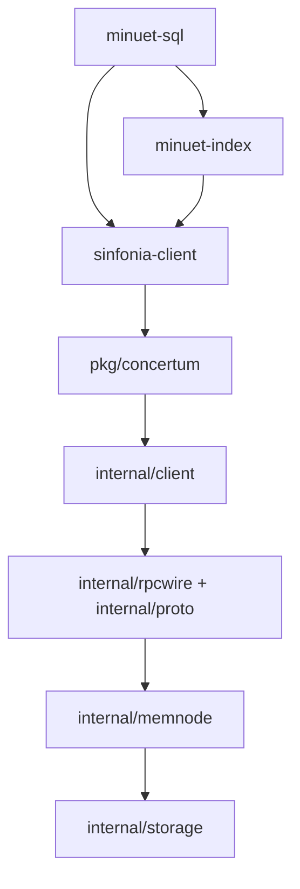

# Design and tradeoffs

## Dependency structure

This is the logical data path; some Go types in the public adapter also refer
to internal node result types. Only the index and SQL layers have the strict
SDK-only dependency boundary.

## Transaction execution

A transaction contains compare, read, and write items addressed by memory-node
ID and byte offset. All addresses are known before prepare begins.

For multiple participants, the coordinator sends the relevant projection to
each node concurrently. Nodes try to acquire range locks without waiting,
evaluate comparisons, collect reads, and log successful write prepares before
voting. Lock conflict triggers bounded backoff and retry with a new transaction
ID. Compare failure is an expected abort.

For ordinary transactions, all positive votes establish the commit decision;
the coordinator has no durable transaction log. Decision delivery is queued
on participant workers and may finish after the API returns. The demo calls
`FlushPendingCommits` before asserting reads or reopening nodes. One-participant
transactions use the combined execute/commit fast path.

An RPC error after a request might have reached a participant does not establish
an abort. The public API distinguishes committed, aborted, and unknown outcomes.
Duplicate request handling preserves original replies and avoids applying a
committed write twice.

The retained `ValidUntil` compare extension uses a durable participant decision
witness for deadline-bearing writes. It is a Concertum extension rather than
a primitive specified by the Sinfonia paper.

## Durability and recovery

Durable nodes retain a disk image, redo entries, decisions, forced-abort
evidence, and replay state. Startup recovery exchanges transaction evidence
with configured peers; missing evidence can block recovery and readiness.
Prepared work must not be treated as aborted just because its coordinator is
unavailable. Redo collection requires evidence that committed updates reached
all required participants. The retained tests exercise interrupted/failed
recovery, forced aborts, partial collection, and replay.

The demo wires recovery peers directly to node instances so the example stays
within one executable. Coordinator operations use TCP with ephemeral loopback
ports. This demonstrates the actual wire path without requiring a manager or
directory service. It verifies an orderly close/reopen, not power-loss durability
or an operational failover deployment.

## Index

The index stores a 64-byte superblock and 512-byte pages at a configured base
address on one participant. Leaves contain ordered `uint64` key/value pairs
and a next-leaf pointer. Internal nodes contain separators and child IDs.
Inserts propagate splits upward; deletes repair underflow by borrowing or
merging and may shrink the root. Existing tests check ordering, separator
routing, occupancy, and leaf linkage through repeated splits and merges.

A mutation builds an in-memory working copy of reachable pages, modifies it,
then compares the original superblock/page bytes and writes the working copy
in one minitransaction. A conflict restarts the operation with bounded retries.
This is coarse optimistic validation; it does not implement Minuet's full
dynamic transaction/caching/multiversion machinery. Search and range scan do
not validate their complete read set, so concurrent updates can make their
page reads inconsistent. The iterator materializes scan results in memory.

Allocated page IDs are not reused. Removed pages are no longer reachable but
their address space is not reclaimed. A long-running workload can exhaust the
configured node memory even if the live tree remains small.

## SQL

The parser and planner support a fixed unsigned `id, value` schema. A 512-byte
catalog stores table records and their primary-index base addresses. Each
operation uses the Sinfonia-backed index; same-engine writes to the same key
are serialized by key locks. There is no general SQL transaction manager.

The catalog's 1024-byte region reservation is not enough to isolate arbitrarily
growing indexes. The sample uses one two-row SQL table. Supporting multiple
growing tables requires explicit bounded regions or a shared page allocator.
Concurrent DDL and consistent scans alongside writers are not guaranteed here.

## What was simplified

The extraction reduces breadth and setup, leaving the transaction and index
implementations intact. It excludes Rust, filesystem/mount adapters, key/value,
object storage, scheduler/log/coordination services, platform/catalog/tenancy,
chaos infrastructure, compatibility-factory tooling, operator daemons, packaging,
and hosted workflows. Eight test files depending on excluded infrastructure are
listed individually in the source manifest. The retained tests and the new
end-to-end demo test run independently of the original checkout.

Research references and the exact source revision are linked in the README
and extraction document. The repository's code, tests, and documented limits
define this sample; paper names describe lineage, not full compatibility.
