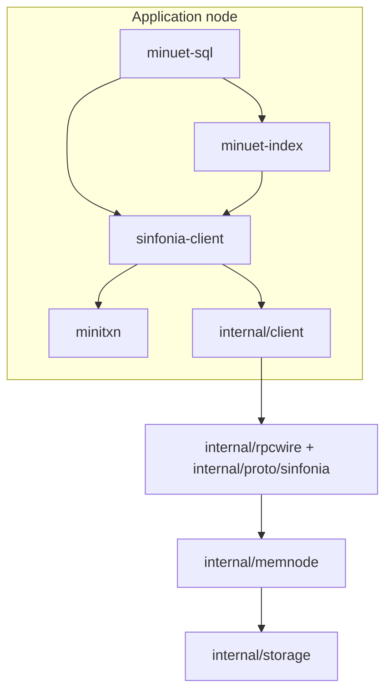

# How it works

## The layers

The Sinfonia user library and coordinator run in the application process. The
library provides reads, writes, transactions, and node stats. Index and SQL code
use the same client and transaction result types; the coordinator and RPC details
are internal implementation packages.

`MiniTransaction` holds comparisons, reads, and writes. It copies the supplied
bytes so changing the caller's buffer won't change the transaction. Its host
helpers return copies too. An `Executor` connects the builder to the client;
there's no global list of hosts. Public items use `HostId`, `Address`, and
`Length`; the wire messages keep their older field names for compatibility.

## A transaction

All byte addresses must be known before the transaction starts. For a transaction
that touches several nodes, the coordinator sends each node its part in parallel.
Each participant tries to lock its ranges without waiting, checks comparisons,
collects reads, and logs prepared writes before voting yes in durable mode.
A participant with no local writes still logs its yes vote if the transaction
writes elsewhere, so recovery can account for everyone's vote.

Readers can share locks. A writer needs exclusive access to its range. The lock
scan checks all earlier readers that might overlap, including a long reader
hidden behind a shorter one. A lock conflict triggers backoff and a bounded
number of retries with fresh transaction IDs. A failed comparison aborts.

For ordinary transactions, everyone's yes vote establishes the commit decision.
The coordinator has no durable transaction log. Workers send decisions in the
background, so `ExecuteAndCommit` can return before all nodes have applied their
writes. `FlushPendingCommits` waits for delivery and reports delivery errors.
A transaction that touches just one participant uses a combined execute/commit
call instead.

If an RPC fails after the request might have arrived, the caller can't assume
the transaction aborted. The API reports committed, aborted, or unknown.
Participants remember replies so duplicate requests can get the same result
without applying writes twice.

## Disk storage and recovery

A durable node saves its memory image, redo entries, decisions, forced-abort
records, and earlier replies. On restart it uses those records and asks recovery
peers for evidence about unfinished transactions. Missing evidence can keep it
from finishing recovery or serving requests. A coordinator disappearing doesn't
give a prepared participant permission to abort on its own.

Old redo entries can be removed once there's enough evidence that the committed
updates reached all required participants. Tests cover interrupted recovery,
failed writes, duplicate requests, forced aborts, and log cleanup.

In the demo, recovery peers call each other directly inside one process. Client
requests use TCP on local, automatically assigned ports. Reopening the saved
files demonstrates an orderly restart. The demo doesn't test a real cluster,
automatic failover, or sudden power loss.

## The B+tree

Each tree sits on one participant, at a chosen base address. A 64-byte superblock
holds the root page ID, next page ID, and update counter. Nodes use 512-byte pages
with up to eight keys each.
Leaves store sorted `uint64` keys and values plus a link to the next leaf;
internal nodes store separator keys and child page IDs.

An insert can split a full node and eventually create a new root. A delete can
borrow from a sibling or merge nodes, and may shrink the root. Tests check key
order, child routing, node sizes, and leaf links through repeated splits and
merges.

An update reads the reachable pages into a working copy and changes that copy.
It then compares the original superblock and page bytes and writes the result
in one minitransaction. If the comparisons fail, it reloads and tries again.
Reading the whole tree keeps this simple, but makes updates expensive.

Searches and scans read pages without validating the whole set afterward. A
concurrent writer can therefore make those reads inconsistent. The iterator
holds all scan results in memory. There are no multiversion snapshots, writable
clones, proxy caches, or trees split across participants.

Page IDs only increase; deleted pages aren't reused. Repeated updates can run
out of address space even when the live tree is small. Also, an invalid superblock
currently looks like an uninitialized tree. A later update can overwrite old
data. A safer design would separate creating a tree from opening an existing one
and report damaged metadata as an error.

## The SQL layer

Tables have two unsigned columns: `id` and `value`. A 512-byte catalog holds up to
six table names and index base addresses. The parser supports `CREATE TABLE`,
`INSERT`, `SELECT` with an optional ID filter, and `DELETE` by ID.

Writes to the same key through one engine are serialized. Each data change uses
the index's transaction path; there's no general SQL transaction manager or
`BEGIN`/`COMMIT` support. Concurrent table creation and consistent scans alongside
writers aren't guaranteed.

The catalog reserves 1024 bytes between table base addresses. That isn't enough
to keep growing indexes from overlapping. The demo uses one small table;
multiple growing tables would need bounded regions or a shared page allocator.

## What's left out

This sample keeps the Go transaction and index core. It leaves out the larger
project's Rust code, filesystem adapters, other storage services, operator
daemons, deployment tools, and hosted workflows. The [README](../README.md)
links the papers that inspired it.
